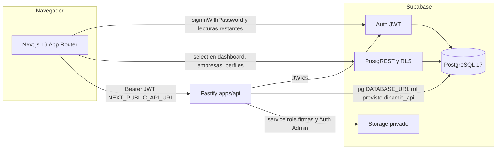

# 02 — Arquitectura actual verificada

Clasificación usada en este documento: `VERIFIED` (visto en código, Git o API de inventario), `PARTIALLY_VERIFIED`, `NOT_VERIFIED`, `NOT_ACCESSIBLE`, `NOT_APPLICABLE`.

## Mapa verificado

## Frontend

| Hecho | Clase | Evidencia |
|-------|-------|-----------|
| Next.js `16.4.3`, React `19.2.4`, TypeScript 5, Tailwind 4, Vitest 3 | VERIFIED | `package.json` |
| App Router, ~50 `page.tsx` bajo `src/app/` | VERIFIED | inventario de `src/app/**/page.tsx` |
| Sin Redux ni Zustand. Estado local y Server Components | VERIFIED | `package.json` no declara esas librerías |
| Cliente HTTP tipado generado | VERIFIED | `src/lib/api/browser.ts`, `src/lib/api/server.ts`, `src/lib/api/generated/client.ts` |
| URL de API por entorno | VERIFIED | `NEXT_PUBLIC_API_URL` y `API_URL` en `.env.example` |
| Proyecto Supabase por entorno | VERIFIED | `NEXT_PUBLIC_SUPABASE_URL` y anon key en `src/utils/supabase/client.ts` y `server.ts` |
| Login con contraseña, sin callback OAuth en código | VERIFIED | `src/app/login/page.tsx` redirige a `/` |
| Proxy de sesión y rol de UI | VERIFIED | `src/proxy.ts` usa `getSession()` y `perfiles.rol`. El comentario del archivo dice que no reemplaza RLS |
| Headers de seguridad básicos. CSP no aplicada | VERIFIED | `next.config.ts` líneas 5–18 |
| `vercel.json` ausente. `.vercel` ignorado | VERIFIED | búsqueda de `vercel.json`; `.gitignore` líneas 43–44 |
| Proyecto, dominios y variables Vercel reales | NOT_ACCESSIBLE | no hay integración Vercel en el repo ni en las herramientas de esta sesión |

Build: `npm run build` → `next build`. Las variables `NEXT_PUBLIC_*` quedan fijadas en el build. Dos frontends simultáneos son posibles sin cambiar código, siempre que cada build reciba su propio `NEXT_PUBLIC_SUPABASE_URL`, `NEXT_PUBLIC_SUPABASE_ANON_KEY` y `NEXT_PUBLIC_API_URL`. En esta máquina `.env.local` apunta a `https://edruejzwwnixsjsadbgb.supabase.co` y `http://127.0.0.1:3001`. No hay URLs de producción hardcodeadas en `src/`.

### Dos caminos de datos

Camino API, usado por la mayoría de módulos (ventas, compras, auditorías, clientes, artículos, ausencias, usuarios vía BFF):

1. El browser obtiene la sesión Supabase.
2. `createAuthenticatedBrowserApiClient` / `createAuthenticatedServerApiClient` adjuntan el access token.
3. La API autoriza y habla con PostgreSQL.

Camino PostgREST, todavía activo para lectura:

| Archivo | Operación |
|---------|-----------|
| `src/proxy.ts` | `perfiles.rol` para ocultar rutas |
| `src/app/layout.tsx` | lectura de `perfiles` |
| `src/app/dashboard/page.tsx` | `ordenes_compra`, `clientes`, `asignaciones`, `asistencias`, `empleados` |
| `src/app/empresas/page.tsx` | `select` de `empresas`; la escritura pasa por la API |

No hay `.insert`, `.update`, `.upsert` ni `.rpc` de Supabase en `src/`. `createAdminClient` en `src/utils/supabase/admin.ts` usa `SUPABASE_SERVICE_ROLE_KEY` y no tiene importadores. Sigue siendo código servidor capaz de saltar RLS si alguien lo importa.

El control de navegación en `src/proxy.ts` y `src/utils/permisos.ts` es de interfaz. La autorización efectiva de las rutas API está en `requirePermission` (`apps/api/src/http/plugins/auth.ts`).

## Backend

| Hecho | Clase | Evidencia |
|-------|-------|-----------|
| Fastify 5.12, Node `>=22`, TypeScript ESM | VERIFIED | `apps/api/package.json` |
| Entrada `src/index.ts`: dotenv, `loadEnv`, listen, SIGINT/SIGTERM | VERIFIED | `apps/api/src/index.ts` |
| CORS por lista, credenciales, sin `*` en production | VERIFIED | `apps/api/src/config/env.ts`, `apps/api/src/app.ts` |
| Helmet, rate limit, problem details, `X-Request-Id` | VERIFIED | `apps/api/src/app.ts` |
| JWT vía JWKS `{SUPABASE_URL}/auth/v1/.well-known/jwks.json`, audiencia `authenticated` | VERIFIED | `apps/api/src/infrastructure/auth/jwt.ts`, `.env.example` |
| PostgreSQL con `pg.Pool` max 10, SSL si el host es Supabase | VERIFIED | `apps/api/src/infrastructure/db/pool.ts` |
| RBAC deny-by-default | VERIFIED | `apps/api/src/domain/rbac.ts` |
| `SUPABASE_SERVICE_ROLE_KEY` obligatorio solo si `NODE_ENV=production` | VERIFIED | `assertUsersModuleConfig` en `apps/api/src/app.ts` |
| Health liveness `/healthz` sin DB. Readiness `/readyz` con `select 1` y probes de esquema | VERIFIED | `apps/api/src/http/routes/health.ts` |
| OpenAPI estático `GET /openapi.json`, versión de documento `0.2.0` | VERIFIED | `apps/api/src/http/openapi.ts` |
| La API no aplica migraciones al arrancar | VERIFIED | `src/index.ts` no invoca el runner |

Módulos HTTP registrados en `buildApp`: health, me, employees, companies, assignments, hr-catalogs, clients, catalog, purchases, results, crm, audits, attendance, hr-reports, users.

Dependencias mínimas para arrancar:

- `DATABASE_URL`, `SUPABASE_URL`, `CORS_ORIGIN` (schema Zod).
- En production, además `SUPABASE_SERVICE_ROLE_KEY`.
- Storage de presupuestos y justificaciones queda en stub 503 si falta la service role (`client-quotes-storage.ts`).
- `MIGRATIONS_DATABASE_URL` no la consume el proceso. Compose la fuerza a vacío.

CORS local verificado en `apps/api/.env`: `http://localhost:3000,http://127.0.0.1:3000`. `HOST=127.0.0.1`, `PORT=3001`, `NODE_ENV=development`, `DB_COMPATIBILITY_TARGET=test`.

Transacciones: los repositorios de clientes, empresas, compras, catálogo, resultados, perfiles y compensación de Auth abren `begin` / `commit` en el pool. No hay un unit-of-work global.

Logging: Pino con redacción de `authorization`, `DATABASE_URL`, service role, JWT y passwords. No hay exportador de métricas, ni campo de commit desplegado, ni alertas en el repositorio.

## Docker

`apps/api/Dockerfile`:

- Multi-stage `deps` → `build` → `runner`.
- Base `node:22-bookworm-slim`.
- Usuario `dinamic` uid/gid 10001, sin shell de login.
- `NODE_ENV=production`, `EXPOSE 3001`, `CMD ["node", "dist/index.js"]`.
- Sin instrucción `HEALTHCHECK` en la imagen. El healthcheck está en Compose.
- Sin versión de imagen distinta de lo que publique quien haga el build.

`deploy/docker-compose.api.yml`:

- Un servicio `api`, imagen `dinamic-clean-api:local`.
- Puerto host `${API_HOST_PORT:-3001}:3001`.
- `env_file: ../apps/api/.env`.
- `HOST=0.0.0.0`, `PORT=3001`, `MIGRATIONS_DATABASE_URL=""`.
- Healthcheck a `http://127.0.0.1:3001/readyz`.
- `restart: unless-stopped`.
- Sin `mem_limit`, `cpus`, red con nombre fijo, volumen de datos ni segundo servicio.
- Comentario del archivo: uso local/staging, no Kubernetes.

Dos instancias simultáneas son posibles solo si se separan project name de Compose, puerto host, archivo de entorno, nombre de contenedor y vhost. Con este archivo tal cual, la segunda copia choca en el puerto 3001 y reutiliza el mismo `.env`.

Señales: `index.ts` cierra Fastify y el pool en SIGTERM, con `SHUTDOWN_TIMEOUT_MS` default 10000. Docker envía SIGTERM al PID 1. No hay `tini`.

## Infraestructura fuera del repositorio

| Pieza | Clase |
|-------|-------|
| Ubuntu, firewall, logs del sistema, backups, monitoreo del VPS | NOT_ACCESSIBLE |
| Nginx, certificados, dominios públicos | NOT_ACCESSIBLE. Cero archivos nginx en el repo |
| Registro de contenedores | NOT_ACCESSIBLE. No hay referencia en workflows |
| Runbook `docs/phase-1-deploy-runbook.md` citado por `apps/api/README.md` | NOT_VERIFIED. El archivo no está |

Comandos de solo lectura para completar el relevamiento del VPS, sin imprimir secretos, están en `11-evidence-index.md`.

## Relación con producción conocida

El Compose y el Dockerfile alcanzan para correr la API. No demuestran que producción esté automatizada. El flujo de deploy actual, en lo que el repositorio prueba, es manual: build de imagen local y `docker compose up`. Quién ejecuta eso en el VPS, con qué dominio y con qué base, queda pendiente.
