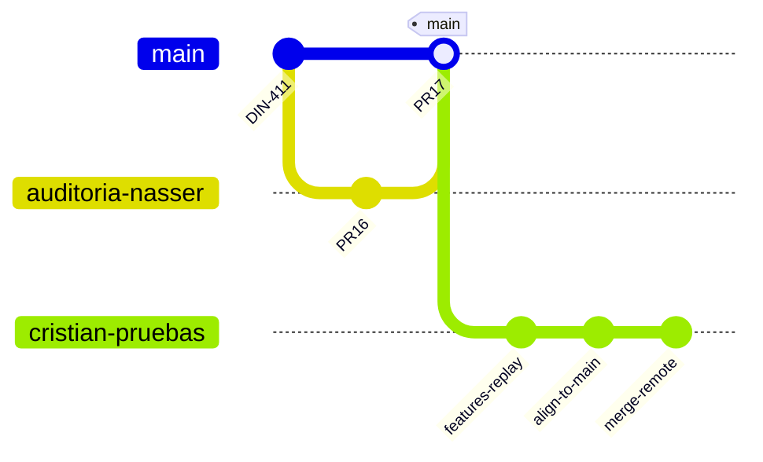
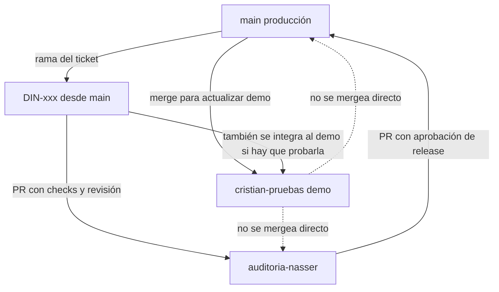

# 04 — Git y estrategia de ramas

Remote verificado: `https://github.com/cnvicario-commits/dinamic-clean-personal.git`. `origin/HEAD` → `origin/main`.

`gh` no está autenticado en esta máquina. Protección de ramas, rulesets y lista de pull requests en GitHub quedan `NOT_ACCESSIBLE`. Los nombres de ramas y los commits salen de `git branch -a` y `git log` locales, actualizados contra los refs de `origin` ya fetched.

## Ramas que existen

| Rama | Punta | Fecha del tip | Árbol |
|------|-------|---------------|-------|
| `origin/main` | `7a69d58` Merge pull request #17 from `auditoria-nasser` | 2026-10-30 | `dc158fccd60f44e91784f020ade52a219d1e96d2` |
| `origin/auditoria-nasser` | `18ec97b` Merge pull request #16 from `DIN-411` | 2026-10-30 | el mismo árbol |
| `origin/cristian-pruebas` | `848a329` Merge de la propia rama remota | 2026-11-02 | el mismo árbol |

`git rev-list --left-right --count`:

| Comparación | Commits solo en la izquierda | Commits solo en la derecha |
|-------------|------------------------------|----------------------------|
| `main...auditoria-nasser` | 1 | 0 |
| `main...cristian-pruebas` | 0 | 13 |
| `auditoria-nasser...cristian-pruebas` | 0 | 14 |

`auditoria-nasser` es ancestro de `main`. El commit extra de `main` es el merge del PR #17 y no cambia archivos (`git diff` vacío). `cristian-pruebas` contiene a `main` y suma 13 commits cuyo diff de archivos contra `main` también es vacío.

Esos 13 commits incluyen, repetidos, mensajes de leads, RLS de ventas y resumen mensual, más:

- `Align cristian-pruebas with main as the source of truth` (dos veces)
- `Keep main's ventas pages after the rebase`
- `Add test change note to README.md` (dos veces)
- `Merge branch 'main' into cristian-pruebas`
- `Merge branch 'cristian-pruebas' of github... into cristian-pruebas`

El flujo acordado ya ocurrió en la práctica y dejó historial duplicado por rebase seguido de merge. El contenido funcional de esas features no está en el árbol: la realineación lo dejó igual a `main`.

También existen ramas locales `DIN-363` … `DIN-411`, `DIN-417` (checkout actual, mismo commit que `auditoria-nasser`), `integration/main-sync` y backups `backup/auditoria-nasser-*`. Varias `DIN-*` siguen en `origin`. No hay `CODEOWNERS` ni plantilla de pull request en el repo.

## Flujo que muestra el historial

El diagrama es esquemático. La punta real de `cristian-pruebas` no modifica el árbol de `main`.

## Evaluación del flujo acordado

Flujo propuesto por el acuerdo: `cristian-pruebas` → rama de ticket → `auditoria-nasser` → `main`.

Es operable para una sola persona y una sola feature. Deja de serlo cuando Cristian acumula varias features en la misma rama, que es lo que el historial ya muestra.

| Pregunta | Respuesta con la evidencia actual |
|----------|-----------------------------------|
| ¿Es viable? | Sí como rama de demo. No como base de tickets |
| ¿Qué riesgo tiene? | El PR arrastra todo lo que esté en `cristian-pruebas` y no en `main`, incluyendo pruebas y features ajenas |
| ¿Varias features a la vez? | Quedan en el mismo diff. No hay forma de mergear una y dejar la otra fuera sin cirugía |
| ¿Evitar cambios no aprobados? | El PR tiene que nacer de commits elegidos sobre `main`, no de la punta de `cristian-pruebas` |
| ¿Features dependientes? | Se apilan en ramas sucesivas basadas en `main`, o se declaran en un solo ticket |
| ¿Sincronizar? | Merge de `main` hacia `cristian-pruebas`. Rebase de una rama que Cristian ya pusheó reescribe historia y produjo los duplicados vistos |
| ¿Conflictos? | Se resuelven en la rama del ticket, contra `main`. La demo absorbe `main` con merge |
| ¿Hotfix? | Rama desde `main`, PR a `main`, después merge de `main` a `auditoria-nasser` y a `cristian-pruebas` |
| ¿Desplegar el commit validado? | El deploy de producción toma el SHA del merge a `main`, no “lo que haya en el servidor” |
| ¿No pisar el trabajo de Cristian? | Nadie hace reset de `cristian-pruebas`. La sincronización es merge. Un reset solo con acuerdo y backup de la rama |

Comparación de técnicas:

| Técnica | Uso recomendado |
|---------|-----------------|
| Merge | Sincronizar `main` → `cristian-pruebas` y promover PRs ya revisados |
| Rebase | Solo en ramas de ticket que todavía no son el entorno compartido |
| Cherry-pick | Rescatar commits concretos que ya viven solo en `cristian-pruebas` hacia una rama nacida en `main` |
| Feature branch | Unidad de revisión. Una por ticket |
| Release branch | `auditoria-nasser` cumple ese papel de cola de promoción, no de desarrollo diario |
| PR | Único camino de entrada a `auditoria-nasser` y a `main` |

## Flujo recomendado

Cristian sigue teniendo su entorno y su rama. La rama deja de ser el origen de los pull requests.

Reglas:

1. `cristian-pruebas` se despliega sola. Puede contener trabajo sin revisar. Eso es aceptable en el entorno de test.
2. Cuando una feature está lista, se abre ticket y una rama `DIN-xxx` desde `origin/main`. Si los commits ya están solo en la demo, se cherry-pickean esos commits, no la rama entera.
3. El PR entra a `auditoria-nasser`. El diff contra `main` tiene que ser solo ese ticket.
4. `auditoria-nasser` no recibe merges de `cristian-pruebas`.
5. `main` solo recibe PRs desde `auditoria-nasser` cuyo SHA ya pasó el gate. Si `auditoria-nasser` y `main` se desfasan, primero se mergea `main` en `auditoria-nasser`.
6. Hotfix: desde `main`, después se baja a las otras dos ramas con merge.

Estado de hoy: las tres ramas tienen el mismo código, así que el primer ticket nuevo puede nacer de `main` sin arrastrar deuda de archivos. La deuda es de historial. Conviene no rebasear `cristian-pruebas` otra vez para “limpiarla”; se deja y de aquí en adelante se mergea.

Protección a configurar en GitHub cuando haya acceso de admin (hoy `NOT_ACCESSIBLE`):

- `main`: PR obligatorio, checks del nivel 3, sin push directo, sin force-push.
- `auditoria-nasser`: PR obligatorio, checks del nivel 2, una revisión de código, sin push directo.
- `cristian-pruebas`: push permitido para Cristian. Sin secretos de producción en los workflows que esa rama puede editar. Force-push deshabilitado para no repetir el rebase que duplicó commits.
