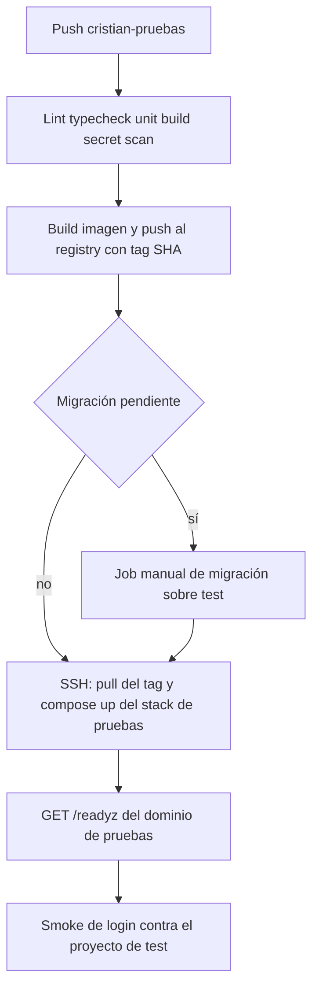

# 06 — Diseño de CI/CD

Diseño. No se agregan workflows en esta auditoría.

## Estado actual

| Mecanismo | Evidencia | Automatizado |
|-----------|-----------|--------------|
| CI de lint, tipos, build y tests unitarios de API | `.github/workflows/ci.yml` | Sí, en `main` y en pull requests |
| Tests de frontend | script `test` en `package.json` | No entra al workflow |
| Integración Postgres | flags en los tests | No |
| Build de imagen | `apps/api/Dockerfile` | Manual |
| Publicación a registry | — | No existe |
| Deploy API | `deploy/docker-compose.api.yml` | Manual, y el runbook citado no está en el repo |
| Deploy frontend | README genérico de Next menciona Vercel | `NOT_ACCESSIBLE`. No hay `vercel.json` ni project link versionado |
| Migraciones | `scripts/apply-forward-migrations.sh` | Manual, con `MIGRATIONS_DATABASE_URL` |
| Secretos de GitHub | — | `NOT_ACCESSIBLE` (`gh` sin login) |
| Webhooks propios | — | No hay en el repo |

El workflow usa `actions/checkout@v4` y `actions/setup-node@v4` sin `permissions:` explícito. No declara `environment:`. No hay `pull_request_target`.

## Pipeline de `cristian-pruebas`

Disparador: push a `cristian-pruebas`. El job de deploy usa el environment `cristian-pruebas`.

El frontend lo construye Vercel en el proyecto separado, con las variables de test. El workflow de GitHub no necesita desplegar Next si Vercel ya observa la rama. El workflow sí debe fallar el conjunto si la API no queda ready, y el proyecto Vercel debe usar el dominio de la API de pruebas. Eso se verifica con un smoke que lea una ruta pública de configuración o el propio login, no con el hecho de que `docker compose up` haya devuelto 0.

Migraciones: etapa aparte, `workflow_dispatch` o environment con aprobación, contra `MIGRATIONS_DATABASE_URL` del proyecto de test. Un push de código no aplica SQL. Motivo: el runner actual no tiene down automático seguro, y el demo lo usa gente de la empresa.

## Comparación de mecanismos de deploy

| Opción | Encaje con lo que hay | Riesgo principal |
|--------|----------------------|------------------|
| GitHub-hosted + registry + SSH a Compose | Alto. Ya existe un Compose de un servicio | Hay que restringir la llave SSH al directorio del stack de pruebas |
| GitHub-hosted + SSH que hace `git pull` y build en el VPS | Menos piezas | El VPS compila, y un push malicioso ejecuta el Dockerfile ahí |
| Runner self-hosted en el VPS | Menos red | El workflow de `cristian-pruebas` corre dentro de la máquina que también puede tener producción |
| Kubernetes u orquestador nuevo | No hay manifest ni necesidad demostrada | Complejidad sin un segundo equipo de plataforma |

Recomendación: GitHub-hosted runner, imagen en GHCR etiquetada con el SHA, deploy por SSH. Usuario de sistema `deploy-cristian` con permiso de Docker solo sobre el proyecto Compose `dinamic-clean-cristian`. El directorio de producción no es escribible por ese usuario. Sin Kubernetes.

Rollback del demo: el host guarda el tag anterior en un archivo `RELEASED_SHA`. Si `/readyz` falla, el script vuelve a levantar ese tag y el job termina en rojo. Éxito = `/readyz` 200 y el SHA reportado por el proceso igual al commit del workflow. Hoy `/healthz` no devuelve SHA. Hay que añadir esa identificación en una fase posterior; hasta entonces el smoke compara el SHA que el deploy escribió en un archivo del host, y `/readyz` confirma la base.

## Seguridad del pipeline

`cristian-pruebas` es una rama en la que se puede cambiar `.github/workflows`. Un workflow de esa rama puede imprimir los secretos a los que el job tiene acceso.

Controles:

- Environment `cristian-pruebas`: solo URLs, anon key de test, service role de test, `DATABASE_URL` del rol `dinamic_api` de test, y la llave SSH del usuario `deploy-cristian`.
- Environment `production`: solo jobs de `main`, con revisores. Ahí viven el ref `biectbcujabpjhinouil`, la service role de producción y la llave del usuario de producción.
- `permissions: contents: read` y `packages: write` solo en el job que publica la imagen. El job de deploy no necesita escribir el repo.
- Pin de acciones por SHA cuando se escriba el workflow.
- Nada de `pull_request_target` con checkout del PR.
- El contenedor de pruebas ejecuta la guardia de ref antes de escuchar. Si el env está cruzado, el proceso sale 1 y el health falla.
- `MIGRATIONS_DATABASE_URL` no entra al contenedor. Compose de producción ya lo pone vacío. El de pruebas tiene que hacer lo mismo.
- Tokens de Vercel del proyecto de producción no se copian al proyecto de pruebas.

La protección de ramas en GitHub no se pudo leer. Hasta configurarla, un push directo a `main` seguiría siendo posible y el diseño de environments no alcanza.

## Fallos

| Falla | Resultado esperado |
|-------|--------------------|
| Lint, tipos, tests o build | No hay imagen nueva. El demo sigue en el SHA anterior |
| Push al registry | No hay deploy |
| `compose up` falla | Job rojo. Se reintenta el tag anterior si el nuevo contenedor no reemplazó al viejo |
| El contenedor arranca y `/readyz` no da 200 | Job rojo. Rollback al tag anterior. Logs de `docker logs` del servicio conservados como artefacto |
| Migración incompatible | No se cambia la imagen. La base queda en la transacción fallida del runner (el script usa `ON_ERROR_STOP` y commit por archivo). Se restaura backup si un archivo anterior de la misma tanda sí commiteó |
| Health en verde y smoke de login en rojo | Job rojo. No se declara el deploy exitoso |

Identidad del deploy: tag de imagen = SHA de Git. Variable `APP_RELEASE_SHA` inyectada al proceso y devuelta por `/healthz` cuando se implemente. Hasta ese cambio, el archivo `RELEASED_SHA` del host es la fuente.

Logs: Pino ya redacta secretos y emite `request.id`. En el VPS, el log del contenedor de pruebas va a un archivo rotado distinto del de producción. No hay agente de alertas en el repo; la alerta mínima del primer pipeline es el mail/check rojo de GitHub.
