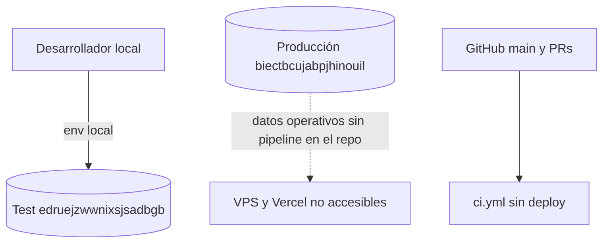
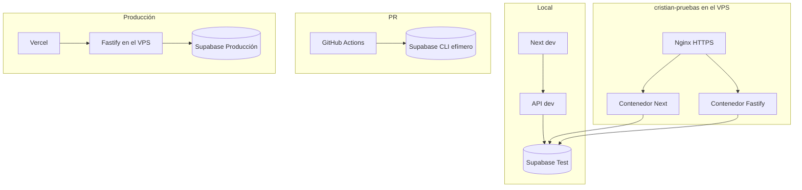
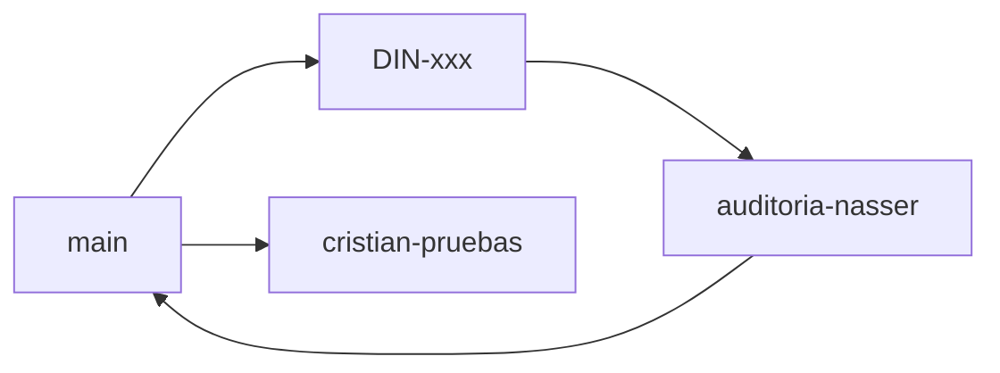
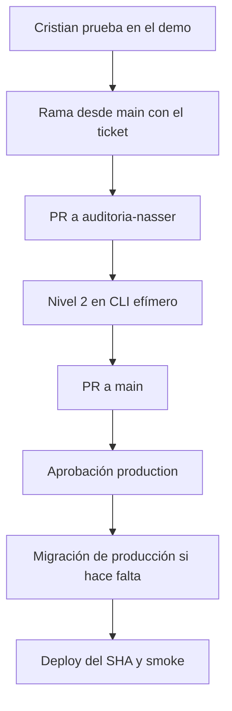

# 07 — Arquitectura objetivo

## Entornos

| | Local | `cristian-pruebas` | Integración | Producción |
|--|-------|--------------------|-------------|------------|
| Rama | la de trabajo del desarrollador | `cristian-pruebas` | efímera, en el PR a `auditoria-nasser` | `main` |
| Frontend | `next dev` en :3000, contra Supabase Test | Contenedor Docker en el mismo VPS, detrás de Nginx | No persistente. El build de CI basta | Proyecto Vercel de producción |
| Backend | `npm run dev` en :3001, contra Supabase Test | Otro contenedor Docker en el mismo VPS, si la capacidad lo permite | No persistente | Contenedor Fastify del VPS |
| Base | Supabase Test `edruejzwwnixsjsadbgb`, compartida con la demo | la misma Supabase Test | Supabase CLI del job | `biectbcujabpjhinouil` |
| Auth y Storage | los del stack local | los del proyecto de test | los del CLI | los de producción |
| Credenciales | `.env` local, gitignored | Environment GitHub `cristian-pruebas` y env de Vercel de ese proyecto | generadas por el job | Environment `production` y env de Vercel de producción |
| Migraciones | libres sobre la base desechable | job con aprobación, después de backup | cada PR, desde cero | ventana con backup y precheck |
| Tests | unitarios al commitear | nivel 1 | nivel 2 bloqueante | nivel 3 sobre el SHA ya verde |
| Deploy | ninguno | push de la rama, si el nivel 1 pasa | ninguno a un servidor | aprobación y smoke |
| Acceso | desarrolladores | Cristian y usuarios de prueba de la empresa | el runner | operación |
| Rollback | recrear la base local | tag de imagen anterior | se descarta el runner | tag anterior. SQL destructivo solo con backup |

### Por qué no hay un servidor persistente para `auditoria-nasser`

Esa rama es una cola de revisión. El 2026-11-05 su árbol es idéntico a `main` y a `cristian-pruebas`. Un cuarto entorno con base propia duplicaría migraciones y datos sin un usuario que lo pruebe: quien prueba funcionalmente usa `cristian-pruebas`. Los defectos de integración los tiene que encontrar el CI efímero del PR. Un preview de Vercel por PR es opcional y puede apuntar a un API efímero solo si más adelante hace falta ver UI. No es requisito de la primera entrega.

## Matriz de aislamiento

| Desde \\ hacia | Local | Test cloud | Producción |
|----------------|-------|------------|------------|
| Proceso local de desarrollo | no es el destino de `npm run dev` | destino compartido con la demo | rechazado si el ref no coincide con Test |
| Contenedor `cristian-pruebas` | no | mismo proyecto Test | el proceso no arranca si el ref es el de producción |
| CI del PR | no | no | sin secretos de ese environment |
| API de producción | no | no | único destino |
| Runner de migraciones de test | no | `MIGRATIONS_DATABASE_URL` de test, fuera del contenedor | no está en ese environment |
| Runner de migraciones de producción | no | no | solo environment `production` |

## Diagramas

### Actual, verificada

### Objetivo

### Git

### Promoción

## Observabilidad mínima para reconocer un deploy

Hoy `/healthz` responde `{ status: 'ok' }` sin versión (`apps/api/src/http/routes/health.ts`). `/readyz` sí distingue base caída y esquema incompatible de fase 2D/3A.

Para cada instancia, el objetivo es poder responder:

| Pregunta | Cómo |
|----------|------|
| Qué versión corre | `APP_RELEASE_SHA` en `/healthz` y tag de imagen igual al SHA |
| Qué migraciones tiene | `select filename from app_migrations.forward_history` ejecutado por un operador, no por el proceso web |
| Si la base responde | `/readyz` 200 |
| Si el frontend habla con esa API | `NEXT_PUBLIC_API_URL` del build de ese proyecto Vercel, comprobado en el smoke |
| Si el deploy dejó errores | logs Pino del contenedor de esa instancia, con `request.id` ya implementado |

CPU, memoria y alertas no están en el repo. En Compose se fijan límites del servicio de pruebas para que no compita sin tope con producción en el mismo VPS. La alerta del primer corte es el check de GitHub en rojo más el fallo de `/readyz`.
