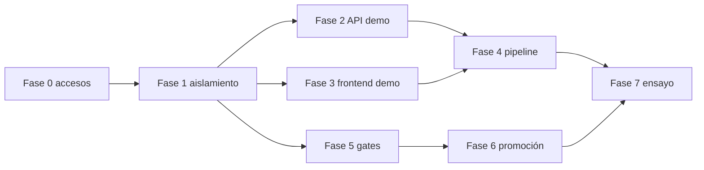

# 08 — Plan de implementación

Cada fase se cierra con evidencia ejecutable. No hay estimación de días: el VPS, Vercel y los permisos de GitHub no se pudieron medir.

Dependencia real, distinta del orden narrativo: el gate de CI sin deploy (parte de las fases 4 y 5) puede existir antes del contenedor. El deploy no puede existir antes del aislamiento de secretos y del segundo stack.

## Fase 0 — Relevamiento y decisiones

Objetivo: cerrar lo que esta auditoría dejó `NOT_ACCESSIBLE` y dejar escrita la decisión de VPS único frente a VPS separado.

Problema: sin el VPS y sin Vercel, un pipeline se diseñaría contra una máquina que no vimos.

Tareas:

- Correr el checklist de solo lectura de `11-evidence-index.md` en el VPS.
- Confirmar proyecto Vercel, rama de producción, dominios y si las variables de Production apuntan a `biectbcujabpjhinouil`.
- Autenticar `gh` y leer protection de `main`, `auditoria-nasser` y `cristian-pruebas`.
- Leer `app_migrations.forward_history` en ambos proyectos, sin volcar connection strings.
- Confirmar si `perfiles` y Auth del proyecto de test tienen usuarios de prueba.
- Decidir dominio de pruebas y si el segundo API vive en el mismo VPS.

Archivos previstos: ninguno de runtime. Notas en esta carpeta, si se actualiza el índice de evidencia.

Recursos: acceso SSH de lectura, acceso Vercel, admin de GitHub, backup ya existente o constancia de que no hay.

Dependencias: ninguna.

Riesgos: encontrar que producción y test comparten un secreto en el host.

Complejidad: baja de código, alta de acceso.

Aceptación: una nota con puertos publicados, vhosts, project refs reales del proceso en producción, y la decisión de VPS firmada.

Cierre: no queda un componente crítico sin clasificar.

## Fase 1 — Aislamiento

Objetivo: que el demo y el CI no puedan abrir producción, y que los tests dejen de escribir en la base del demo.

Problema: la misma `DATABASE_URL` de test sirve para desarrollar, migrar y, si el flag está puesto, integrar.

Tareas:

- Documentar el environment `cristian-pruebas` y el environment `production` con secretos disjuntos.
- Añadir la guardia de arranque: ref distinto de `biectbcujabpjhinouil` cuando el target declarado es test.
- Pasar la integración local al CLI o a una base desechable.
- Hacer que las suites que hoy solo miran `DATABASE_URL` usen `assertDinamicCleanTestTarget`.
- Aplicar, en ventana y con backup, las forward que le faltan al proyecto de test. Confirmar las tres tablas y el libro de historial.
- Crear perfiles de prueba. No copiar la base de producción con datos de empleados y clientes.

Archivos previstos: `apps/api/src/index.ts` o `config/env.ts` para la guardia, `apps/api/tests/supabase-test-guard.ts` y las suites que no lo llaman, `.env.example`. Sin commitear `.env`.

Recursos: backup del proyecto de test, rol de migración de test.

Dependencias: fase 0.

Riesgos: la puesta al día del esquema de test rompe el demo vacío si hay datos residuales incompatibles. Por eso el backup va primero.

Complejidad: media.

Aceptación: un proceso con `DB_COMPATIBILITY_TARGET=test` arranca contra `edruejzwwnixsjsadbgb` y sale con error si se le inyecta el ref de producción. `npm test` de API, sin flags, no abre conexiones al pooler de us-west-2.

Cierre: evidencia del comando de arranque rechazado y del test suite sin red de Supabase.

## Fase 2 — API de `cristian-pruebas`

Objetivo: un segundo proceso en el VPS, o en otra máquina si la fase 0 lo exige, con dominio y HTTPS propios.

Problema: el Compose actual es un solo servicio en el puerto 3001, sin límites y con el `.env` de desarrollo.

Tareas:

- Compose de proyecto `dinamic-clean-cristian`, puerto host distinto, `env_file` distinto, `MIGRATIONS_DATABASE_URL` vacío, `mem_limit` y `cpus`, `restart: unless-stopped`.
- Usuario de sistema y directorio separados de producción.
- Vhost Nginx y certificado para el dominio de pruebas. `TRUST_PROXY_CIDRS` con la IP del proxy, nunca `*`.
- `CORS_ORIGIN` con el origen exacto del frontend de pruebas.
- Logs rotados aparte.
- Healthcheck de Compose ya existente, contra `/readyz`.

Archivos previstos: un compose nuevo bajo `deploy/`, ejemplo de env sin secretos, fragmento de Nginx versionado si el equipo decide dejar de administrar el proxy solo a mano.

Recursos: DNS, certificado, puerto libre, confirmados en fase 0.

Dependencias: fase 1.

Riesgos: el proxy de producción y el de pruebas compartan un default_server y filtren tráfico. Se prueba con `curl` al vhost.

Complejidad: media.

Aceptación: `curl` a `/readyz` del dominio de pruebas devuelve 200 y el proceso reporta el ref de test. El contenedor de producción sigue respondiendo en su dominio.

Cierre: los dos healthchecks en el mismo minuto, más `docker stats` mostrando el límite aplicado.

## Fase 3 — Frontend de pruebas en el VPS

Objetivo: el frontend de `cristian-pruebas` corre en un contenedor Docker del mismo VPS que el API, no en otro proyecto Vercel.

Problema: `NEXT_PUBLIC_*` se hornean en el build. El deploy tiene que publicar el frontend y el backend del mismo commit, en imágenes independientes.

Tareas:

- Imagen del frontend distinta de la imagen del API. Tag de las dos = el mismo SHA. Si una no construye, no se publica ninguna.
- Contenedor propio, vhost Nginx y certificado. El dominio entra en las redirect URLs de Auth del proyecto Test.
- Variables de build: URL y anon key de `edruejzwwnixsjsadbgb`, `NEXT_PUBLIC_API_URL` del dominio del API de pruebas. La service role no lleva prefijo `NEXT_PUBLIC_`.
- Smoke: login de un usuario de prueba, una pantalla que use la API y el dashboard.

No se crea un segundo proyecto Vercel.

Dependencias: fase 1 y, para el smoke completo, fase 2. El VPS sigue sin relevar; eso condiciona el tamaño del contenedor, no el diseño.

## Fase 4 — CI/CD del demo

Objetivo: push a `cristian-pruebas` deja el SHA corriendo, o no toca el proceso si algo falla.

Problema: hoy ese push no dispara ni el CI.

Tareas:

- Workflow de nivel 1.
- Dos imágenes independientes, frontend y API, con el mismo SHA y digest propio. El deploy las publica juntas o no toca el VPS.
- Nginx sirve el contenedor del frontend y proxeá el API. HTTPS en los dominios de prueba.
- Deploy SSH con el usuario de la fase 2. Sin secretos de producción en el workflow de la rama.
- Smoke `/readyz` y rollback al par de tags anterior.
- Job de migración separado, con aprobación, desconectado del push ordinario.
- Artefacto de logs si el health falla.

Archivos previstos: `.github/workflows/` nuevo. No se escribe en esta auditoría.

Recursos: environment de GitHub, GHCR, llave SSH de alcance mínimo.

Dependencias: fases 1, 2 y 3.

Riesgos: el workflow de la rama lee secretos de más. La prueba de la fase 7 incluye un workflow que intenta imprimir una variable de production y tiene que fallar por ausencia.

Complejidad: media.

Aceptación: un push de prueba despliega el SHA. Un commit que rompe el build deja el SHA anterior respondiendo `/readyz`.

Cierre: los dos ensayos registrados con URL de check de GitHub, sin secretos en el log.

## Fase 5 — Quality gates

Objetivo: `auditoria-nasser` no se mergea sin CI real de base.

Problema: el CI actual marca verde con la integración salteada, y el frontend no corre sus tres tests.

Tareas:

- Incluir `npm test` de frontend.
- Job con Supabase CLI, baseline + forward, suites de integración que ya tienen guardia.
- Check de contratos generados.
- Branch protection: cuando haya permiso de administración. Hasta entonces queda `GITHUB_BRANCH_PROTECTION_DEFERRED` y no bloquea el código de la fase 1. La revisión del PR la hace el responsable técnico.
- Informe de cobertura publicado, sin umbral hasta tener el número.

Archivos previstos: workflow, quizá `apps/api/package.json` script de integración contra el CLI. Tests existentes se conservan; se extiende la guardia.

Recursos: minutos de Actions.

Dependencias: fase 1. Puede avanzar en paralelo con la 2.

Riesgos: el CLI en Actions tarda o no reproduce una extensión. Si falla, se documenta el hueco y no se declara el gate equivalente a producción.

Complejidad: media-alta por el tiempo de CI, no por código nuevo de producto.

Aceptación: un PR con un test roto no se puede mergear. Un PR verde muestra el job de migraciones aplicadas desde cero.

Cierre: captura del ruleset y de un PR rechazado por el check.

## Fase 6 — Promoción

Objetivo: el acuerdo con Cristian queda escrito en el recorrido de ramas, sin usar `cristian-pruebas` como base del PR.

La cobertura de integración que el CLI efímero todavía no ejecuta queda listada en `docs/architecture-audit/phase-1/review-corrections/04-integration-coverage.md` y se cierra en esta fase, no forzando esas suites dentro del job actual.

Problema: el historial ya tiene rebase y commits duplicados.

Tareas:

- Convención `DIN-xxx` desde `main`.
- PR solo hacia `auditoria-nasser`, y de ahí hacia `main`.
- Prohibido el PR `cristian-pruebas` → `main`.
- Merge de `main` hacia `cristian-pruebas` cuando producción avance. Sin rebase de la rama compartida.
- Hotfix de ensayo documentado en una página corta para Cristian y para quien revisa.
- Environment `production` con revisor.

Archivos previstos: ninguna regla de Git vive en el repo hoy. La protección es de GitHub. Una nota operativa puede vivir en `docs/` cuando se pida; no forma parte de esta auditoría.

Dependencias: fase 5 para que el PR tenga checks. La convención de ramas puede explicarse antes.

Riesgos: Cristian sigue abriendo el PR desde la demo por costumbre. El ruleset de `auditoria-nasser` puede exigir que la rama base del PR sea `auditoria-nasser` y que el diff no incluya merges de la demo. Eso se revisa en el PR, no solo con un cartel.

Complejidad: baja de código, alta de hábito.

Aceptación: un ticket de prueba recorre demo → rama desde main → `auditoria-nasser` → `main` sin arrastrar commits ajenos.

Cierre: el PR de prueba muestra un diff acotado y los checks del nivel 2.

## Fase 7 — Validación integral

Objetivo: ensayar las fallas antes de darle el entorno a la empresa.

Tareas:

- Push bueno a `cristian-pruebas`.
- Push con test roto.
- Push con migración incompatible en el job manual, sobre una base desechable, no sobre el demo.
- Rollback de imagen.
- Intento de secret de producción desde el workflow de pruebas.
- Login de punta a punta en el dominio nuevo.
- Confirmar que producción no cambió de SHA durante los ensayos.

Dependencias: 2, 3, 4, 5 y 6.

Aceptación: cada falla deja el sistema de pruebas en el SHA anterior o detenido, con el check rojo, y producción intacta.

Cierre: lista de `10-validation-checklist.md` marcada con enlaces a los runs. Ahí termina la habilitación del flujo.
