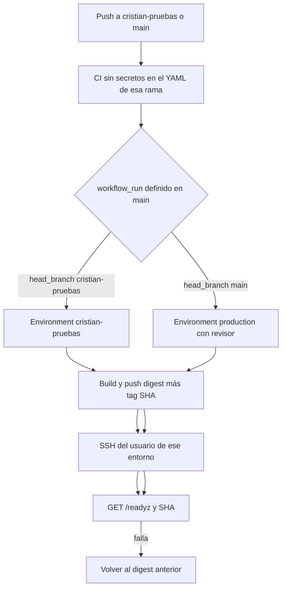

# 05 — Revisión de seguridad del CI/CD

Se valida `docs/architecture-audit/06-cicd-design.md`. El mecanismo (runner de GitHub, GHCR, SSH, Compose, sin Kubernetes) se mantiene. Se corrige quién posee el YAML privilegiado.

## Flujo

| Paso | Dónde vive | Evidencia de cierre |
|------|------------|---------------------|
| 1. Validación | CI sin secretos. Lint, typecheck, unit tests, build, scan | Check de GitHub del SHA |
| 2. Imagen | Job de `main`, `docker buildx` | Digest `sha256:` en el summary |
| 3. Identidad | Tag = SHA completo y digest inmutable | El deploy usa el digest |
| 4. GHCR | `packages: write` solo en ese job | Paquete visible, sin borrar tags ajenos |
| 5. Identidad de deploy | Llave del usuario `deploy-cristian` o del usuario de producción, según el environment | El otro directorio no es escribible |
| 6. Health | `/readyz` 200. `/healthz` tiene que devolver el SHA. Hoy no lo hace | Cambio de código posterior, no de esta fase |
| 7. Commit desplegado | El proceso y el archivo `RELEASED_SHA` del host coinciden con `head_sha` | Smoke |
| 8. Rollback | Si `/readyz` no da 200, `compose up` del digest anterior | Job rojo igual |
| 9. Evidencia | Summary del job con SHA, digest y código HTTP. Sin env | URL del run |
| 10. Fallo | El check rojo. No hay otro sistema de alertas en el repo | El check alcanza para el primer corte |

## Correcciones al diseño anterior

El documento 06 hacía correr el deploy en un workflow disparado por push a `cristian-pruebas`. Ese YAML lo puede editar Cristian. El deploy pasa a `workflow_run` definido en `main`, como está detallado en `03-github-security.md`.

La imagen de producción se construye en el job de `main` a partir del SHA de `main`. No se reutiliza una imagen que haya construido un workflow de otra rama, aunque el tag coincida. El digest publicado por el job de `main` es el único que el environment `production` puede levantar.

El frontend de pruebas no se auto-publica en el push. El mismo job llama al deploy hook de Vercel después de `/readyz`. Si el API no queda listo, el frontend anterior sigue sirviendo.

## Fallos

| Falla | Resultado |
|-------|-----------|
| Código no revisado en `cristian-pruebas` | Se despliega solo con secretos de test. Es el objetivo del demo |
| Red caída a mitad del `compose pull` | El contenedor viejo sigue si el `up` no llegó a reemplazarlo. Si quedó a medias, el script vuelve al digest guardado y el job falla |
| Docker no arranca | Job rojo. No se marca el SHA como liberado |
| Migración incompatible | No entra en este flujo. El job de migración es `workflow_dispatch` sobre el mismo YAML de `main`, con revisor, backup previo y `MIGRATIONS_DATABASE_URL` fuera del contenedor. Un push no migra |
| VPS apagado | El SSH falla, el job queda rojo, no hay deploy parcial que declarar exitoso |
| Frontend nuevo y API viejo | El hook corre después del health. La ventana queda cerrada |
| Release con migración | Primero el job de migración contra el entorno destino. Después el deploy de la imagen cuyo código ya entiende ese esquema. El contrato destructivo no viaja en el mismo release que el código viejo todavía podría estar corriendo |

## Secretos

El environment de test no es suficiente si el YAML de la rama lo consume. La separación válida es: credencial en el environment, lógica en el archivo de `main`, rama de Cristian sin `secrets:`.

Variables que el contenedor de pruebas recibe: `DATABASE_URL` de `dinamic_api` en test, `SUPABASE_URL` de test, `SUPABASE_SERVICE_ROLE_KEY` de test, `CORS_ORIGIN` del dominio de pruebas. `MIGRATIONS_DATABASE_URL` vacía, igual que el Compose actual.

El arranque rechaza el ref `biectbcujabpjhinouil`.
