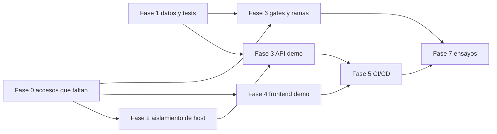

# 08 — Roadmap actualizado

La fase 0 no se marca cerrada. VPS, Vercel y GitHub siguen sin lectura. Ninguna fase posterior se declara hecha.

Corrección de arquitectura, noviembre 2026: el frontend de Cristian no va a un segundo proyecto Vercel. Va a un contenedor Docker del mismo VPS, junto con el API, detrás de Nginx. El detalle está en `docs/architecture-audit/phase-1/review-corrections/06-updated-architecture.md`. `GITHUB_BRANCH_PROTECTION_DEFERRED` no bloquea el avance.

El orden cambia para poner primero el dato y el secreto, y para permitir trabajo en paralelo que no toca el VPS.

La fase 1 no espera al VPS. Las fases 2 y 4 esperan los accesos. La 5 espera API y frontend. La 6 puede avanzar en GitHub en paralelo con la 2, y el CLI de tests en paralelo con la 1.

## Fase 0 — lo que sigue abierto

Objetivo: clasificar VPS, Vercel y GitHub con los procedimientos de `01`, `02` y `03`.

Cierre: hay una nota con contenedores, refs, dominios y rulesets, o una ausencia explícita de cada uno. Sin eso la fase 0 sigue parcial.

## Fase 1 — datos y aislamiento de tests

Objetivo: el código actual puede correr contra test, y `npm test` no puede abrir ni test ni producción.

Problema: faltan 7 migraciones, `purchase_order_create` no entra en el check de test, y `anon` conserva DML sobre `empresas`. El guard actual, fuera de simulation, apunta al proyecto compartido.

Tareas:

- Backup del proyecto test.
- Aplicar el runner forward contra test. Verificar historial, check de compras y grants de `empresas`.
- Setup de Vitest que rechaza los dos refs cloud.
- `npm test` hace unset de las URLs de base antes de correr.
- Las suites de integración quedan en modo simulation.

Archivos previstos: `apps/api/vitest.config.ts`, `apps/api/tests/supabase-test-guard.ts`, las suites que no llaman al guard, `apps/api/package.json` si el script de test debe limpiar el entorno. No se commitean `.env`.

Dependencias: ninguna de infraestructura. El backup sí.

Aceptación de la fase 1, que es el criterio para empezar a construir el demo:

- `forward_history` de test lista los 28 archivos y los checksums siguen igual al repo.
- El check de `purchase_operation_idempotency` incluye `purchase_request_create` y `purchase_order_create`.
- `anon` y `authenticated` no tienen INSERT/UPDATE/DELETE/TRUNCATE sobre `empresas`. `dinamic_api` tiene INSERT y UPDATE.
- `npm test` en `apps/api`, con el `.env` de test exportado en el shell, termina en error antes de conectar, o corre solo con mocks y sin abrir el pooler.
- Una suite simulation contra `127.0.0.1` sí corre.
- Producción no cambia de historial: sigue en 28 y no recibe archivos nuevos.

## Fase 2 — aislamiento del host

Depende del script de `01-vps-verification.md`.

Si el relevamiento muestra puerto libre, RAM para un límite fijo y un env que no es el de producción: usuario `deploy-cristian`, directorio propio, puerto distinto de 3001, vhost propio. Si muestra un único `.env` o el ref de producción en el candidato a env de pruebas: no se instala el segundo stack en ese host.

## Fase 3 — API de pruebas

Compose `dinamic-clean-cristian`, guardia de ref, `/readyz`, logs aparte, límites. El env usa la base ya migrada en la fase 1.

Aceptación: `/readyz` del dominio de pruebas en 200 y el de producción sigue en 200 en el mismo minuto.

## Fase 4 — frontend de pruebas

Proyecto Vercel nuevo. Variables solo de test. Dominio en las redirect URLs de Auth del proyecto test. Deploy hook, no auto-deploy ciego.

Aceptación: el bundle del dominio de pruebas contiene el ref de test y no el de producción. Login de una de las 15 cuentas de prueba.

## Fase 5 — CI/CD

Workflow de CI sin secretos. `workflow_run` en `main` para build, digest, SSH y hook de Vercel. Migración solo por `workflow_dispatch` con revisor.

Aceptación: un push a `cristian-pruebas` que rompe el build deja el digest anterior respondiendo `/readyz`. Un push bueno deja ese SHA.

## Fase 6 — gates y promoción

CLI en el PR. Required check emitido desde `main` o desde ruleset, no desde el YAML del PR. Protection de `main` y `auditoria-nasser`. Procedimiento Git de `07-final-architecture-decisions.md`.

Aceptación: un PR con el job de integración en rojo no se mergea. Un ticket de ensayo no arrastra los merges de realineación de la demo.

## Fase 7 — ensayos

Build roto, health roto, intento de leer un secreto de `production` desde la rama de pruebas, rollback de digest, producción sin cambio de SHA.

## Paralelo permitido

| Se puede hacer junto | No se puede adelantar |
|----------------------|------------------------|
| Fase 1 y el relevamiento de la fase 0 | El segundo contenedor antes del relevamiento y antes de la fase 1 |
| Rulesets de GitHub y el Compose, cuando cada acceso exista | El workflow privilegiado en la rama `cristian-pruebas` |
| Borrador del proyecto Vercel y el API, cuando el dominio del API ya responde | Declarar un gate en verde porque el job de integración fue skipped |
